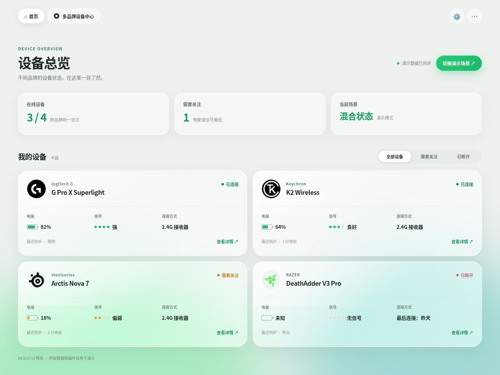

# NEXUS · 2.4G 多品牌设备看板

Windows 桌面 Demo，展示多品牌设备的电量、信号和连接状态，并演示鼠标 DPI 档位切换。目前使用模拟设备适配器，不会向真实硬件发送指令。



桌面程序源码位于 [`desktop-demo/`](desktop-demo/)：Electron 主进程维护设备清单和模拟适配器，预加载层提供受限的设备 API，界面通过该 API 读取状态、切换演示场景和提交 DPI 设置。[`ui-review.html`](ui-review.html) 是独立的视觉预览文件。

开发与测试：

```bash
cd desktop-demo
npm ci
npm test
npm start
```

在 Windows 上运行 `npm run build:win` 可生成 `release/NEXUS-win32-x64/`。打包后需保留整个目录，再双击其中的 `NEXUS.exe`。

真实设备接入需要逐型号确认 VID/PID、通信协议和可用能力，再替换相应的模拟适配器。
